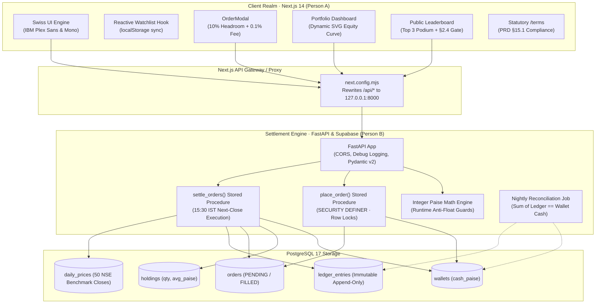

<div align="center">

```
  __  __ _    _ _____  _____            
 |  \/  | |  | |  __ \|  __ \   /\      
 | \  / | |  | | |  | | |__) | /  \     
 | |\/| | |  | | |  | |  _  / / /\ \    
 | |  | | |__| | |__| | | \ \/ ____ \   
 |_|  |_|\____/|_____/|_|  \/_/    \_\  
```

### **मुद्रा · Honest Indian Equities Simulator**
*Paper trading without the delusions. 15:30 IST closing-bell execution, integer paise ledgers, and zero real money.*

[](https://nextjs.org/)
[](https://fastapi.tiangolo.com/)
[](https://www.postgresql.org/)
[](https://supabase.com/)
[](https://www.typescriptlang.org/)
[](https://www.python.org/)
[](client/src/app/terms/page.tsx)

<br />

[Explore 50 Stocks](file:///client/src/app/explore/page.tsx) • [Trading Dashboard](file:///client/src/app/dashboard/page.tsx) • [Trader Leaderboard](file:///client/src/app/leaderboard/page.tsx) • [Statutory Disclaimers](file:///client/src/app/terms/page.tsx) • [Architecture ADRs](file:///.gsd/DECISIONS.md)

---

</div>

## 📖 The Mudra Parable: Why Does This Exist?

Most stock market simulators on the internet are **delusion engines**.

They give you ₹10,00,000 of play money, let you click "BUY" at 11:42 AM, immediately fill your order at a delayed price with zero market impact, zero slippage, and zero emotional weight, and then applaud as your imaginary fortune grows. You start believing you are the next Jhunjhunwala—until you open a real demat account, encounter real-world settlement cycles, real liquidity friction, and discover that the market does not grant instantaneous wish fulfillment.

**Mudra is built on an austere counter-philosophy:**

1. **The Sacred 15:30 IST Cutoff:** You do not get instant fills. Orders placed throughout the day queue up politely like commuters at Churchgate station. When the closing bell strikes at 15:30 IST, all orders settle strictly against the official National Stock Exchange (NSE) end-of-day closing price.
2. **The Sanctity of Integer Paise:** Floating-point math (`0.1 + 0.2 = 0.30000000000000004`) has ruined more financial ledgers than bad market calls. In Mudra, there are no floats. Your starting capital is not `100000.0`. It is exactly `10,000,000` integer paise. Not a single copper coin is ever lost to binary rounding.
3. **The 10% Cash Headroom Sanctuary:** In closing-price simulation, you do not know the exact fill price when you place a market order at 1:00 PM. If the stock rallies +4% before close, a naive simulator leaves you with illegal negative cash. Mudra automatically reserves estimated cost + 10% headroom, refunding the remainder cleanly at settlement.
4. **The Friction Tax:** Every simulated trade incurs a realistic 0.10% (10 bps) brokerage fee. Because in the real world, turning over your portfolio sixteen times a day makes your broker rich, not you.
5. **Anti-Outlier Meritocracy:** You cannot top our public leaderboard with a single lucky YOLO on Monday morning. To qualify for trader rankings, you must survive at least **5 filled trades** across at least **7 distinct trading days**.

---

## 🏛️ System Architecture

Mudra is architected across two distinct, complementary realms: the **Swiss Frontend Realm** (guided by Person A) and the **Python / PostgreSQL Settlement Core** (guided by Person B).



---

## 💎 The Four Pillars of Financial Purity

| Pillar | How Childish Simulators Do It | How Mudra Does It |
|:---|:---|:---|
| **Execution Timing** | Instant fills at stale/cached quotes. Users game intraday momentum without risk. | **Next-Close 15:30 IST**. Orders queue up and execute strictly against official end-of-day closes. |
| **Currency Representation** | JavaScript `Number` or SQL `FLOAT`. Rounding errors accumulate into phantom rupees. | **Integer Paise (`bigint`)**. Everything is stored in paise (`10000000` paise = ₹1,00,000.00). Formatted strictly at presentation layer. |
| **Market Volatility Buffer** | Buy orders fill for all available cash; if price spikes, account goes into negative balance. | **10% Headroom Buffer**. Reserves `est_price * 1.10 + simulated fee`. Excess cash refunded at settlement. |
| **Trader Rankings** | Unranked sorted list where a user who made 1 trade and abandoned the site sits at #1. | **Anti-Outlier Gate (PRD §2.4)**. Minimum 5 filled trades and 7 active days required for leaderboard inclusion. |

---

## 🗺️ Tour of the Application

<div align="center">

| Route | Destination | What Lives Here |
|:---|:---|:---|
| `/` | **The Grand Promenade** | Institutional hero section, value proposition, live market status, and 1-click ₹1,00,000 capital activation. |
| `/explore` | **NSE 50 Benchmark Directory** | 50 liquid Nifty equities, sector filter pills, search bar, sort options, and empty-state watchlist tracker. |
| `/stock/[symbol]` | **The Trading Floor** | High-precision SVG historical price curves, quote timestamps, and full Buy/Sell order sheet with fee math. |
| `/dashboard` | **The Audit Sanctuary** | Net equity curve (1M / 6M / ALL), active holdings table, queued orders, and the append-only Transaction Audit Ledger. |
| `/leaderboard` | **The Hall of Merit** | Top 3 podium cards, full ranked directory, anti-outlier filters, and pinned "Your Standing" progress tracker. |
| `/terms` | **Statutory Legal Disclosures** | PRD §15.1 "No Real Money" disclaimers, DPDP Act 2023 compliance, 18+ gate, and SEBI-unregistered statement. |

</div>

---

## 🛡️ The "No Real Money" Statutory Creed

Mudra is built for education, financial literacy, and intellectual curiosity. It is **not** a casino, a broker, or a financial advisory service.

```
       __________________________________________________________________
      |                                                                  |
      |   [!] STATUTORY SEBI & FINANCIAL DISCLAIMER                     |
      |                                                                  |
      |   * Mudra is NOT a SEBI-registered broker, investment adviser,   |
      |     or research analyst under Indian securities law.             |
      |   * Virtual ₹1,00,000 has ZERO fiat monetary value. It cannot be |
      |     withdrawn, transferred, refunded, or redeemed.               |
      |   * Zero integration with payment gateways, UPI, net banking,    |
      |     Demat accounts, PAN cards, or Aadhaar numbers.               |
      |   * Strictly 18+ educational simulation platform.                |
      |__________________________________________________________________|
```

We ran an exhaustive repository-wide security scan across every single source file:
- **`grep razorpay|stripe|upi_id|aadhaar|pan_number|bank_account|demat_id`** → **0 matches.**
- **`grep reset_wallet|top_up|add_cash`** → **0 matches** *(The No-Reset Rule is absolute; once your ₹1L is spent, you live with your consequences).*

---

## 🛠️ Technology Stack & Ingredients

### Frontend (Person A's Workshop)
- **Framework:** Next.js 14 (`app` router) with React 18 & TypeScript 5.6
- **Styling:** Bespoke Swiss Design System with institutional color tokens (`#0B0E14` obsidian, `#EEA02B` signal yellow, `#3BBFF7` sky blue, `#07A240` link green, `#C92121` node red)
- **Typography:** IBM Plex Sans & IBM Plex Mono via Google Fonts
- **Icons:** Lucide React
- **Client State:** Reactive `useWatchlist` hook with cross-tab `localStorage` synchronization
- **PWA Ready:** Complete OpenGraph, Twitter card, theme-color (`#0B0E14`), and mobile viewport tags

### Backend & Engine (Person B's Engine Room)
- **API Framework:** FastAPI (Python 3.11) with Pydantic v2 schemas
- **Database:** PostgreSQL 17 with Supabase Auth, Triggers, and Row-Level Security
- **Math Engine:** Dedicated integer paise engine (`server/app/core/math.py`) with zero floating-point arithmetic
- **Order Protection:** PostgreSQL stored procedures (`place_order`, `settle_orders`) executing under `SECURITY DEFINER` with table-level client write revocation
- **Settlement Automation:** GitHub Actions EOD cron workflow (`daily-prices.yml`) running at 15:40 IST with 25% price move quarantine guards
- **Reconciliation:** Nightly automated audit script reconciling `sum(ledger_entries.amount_paise) == wallets.cash_paise`

---

## 🚀 Quick Start Guide

Want to run the entire simulation suite locally? Follow the steps below.

### Prerequisites
- **Node.js** `>= 18.18.0` & **npm**
- **Python** `>= 3.10` with `pip`
- (Optional) **Supabase CLI** or PostgreSQL 17 for local database emulation

---

### 1. Clone the Sanctuary
```bash
git clone https://github.com/sharancreates/mudra.git
cd mudra
```

### 2. Fire Up the Frontend (Client)
```bash
cd client
npm install
npm run dev
```
Open **[http://localhost:3000](http://localhost:3000)** in your browser.  
*(Notice: The client runs out-of-the-box with typed mock fixtures for all 50 stocks, leaderboard, and reference portfolio even if the backend is offline!)*

### 3. Fire Up the Backend (Server)
In a separate terminal:
```bash
cd server
python -m venv venv

# Windows
venv\Scripts\activate

# macOS / Linux
source venv/bin/activate

pip install -r requirements.txt
uvicorn app.main:app --reload --port 8000
```
FastAPI documentation will be available at **[http://localhost:8000/docs](http://localhost:8000/docs)**.

### 4. Run the Verification Test Suite
```bash
cd server
pytest -v -s
```
All **30+ tests** (including the reference scenario, integer paise math tests, concurrency loads, and settlement idempotency) will execute in under 2 seconds.

---

## 📂 Codebase Geography

```
mudra/
├── .github/
│   └── workflows/
│       └── daily-prices.yml         # ⏰ 15:40 IST EOD Ingestion, 25% Quarantine & Settlement
├── .gsd/                            # 📋 Get-Shit-Done Agile Planning Artifacts
│   ├── SPEC.md                      # Canonical Project Specification
│   ├── ROADMAP.md                   # Phase-by-phase deliverables roadmap
│   ├── DECISIONS.md                 # Architecture Decision Records (ADR-001 to ADR-012)
│   ├── STATE.md                     # Real-time synchronization state
│   └── phases/                      # Plans, Summaries, and Empirical Verifications
├── client/                          # 🌐 Person A: Next.js 14 Swiss Frontend
│   ├── next.config.mjs              # API proxy rewrites to FastAPI backend
│   ├── src/
│   │   ├── app/
│   │   │   ├── layout.tsx           # Production metadata, OpenGraph & PWA viewport
│   │   │   ├── page.tsx             # Landing Page with ₹1,00,000 Activation CTA
│   │   │   ├── explore/             # 50-Stock Directory with Watchlist Empty States
│   │   │   ├── stock/[symbol]/      # Stock Detail with PriceChart & OrderSheet
│   │   │   ├── dashboard/           # Portfolio Performance Curve & Audit Ledger
│   │   │   ├── leaderboard/         # Public Trader Rankings & Top 3 Podium
│   │   │   └── terms/               # Statutory Disclaimers & PRD §15.1 Compliance
│   │   ├── components/
│   │   │   ├── auth/AuthModal.tsx   # 18+ & Simulation acknowledgement modal
│   │   │   ├── explorer/            # SearchBar, SectorFilterPills, StockTable
│   │   │   ├── mudra/               # MudraShell, MudraHeader, MudraMenu, MudraFooter
│   │   │   ├── stock/PriceChart.tsx # Interactive SVG historical charts
│   │   │   └── trade/OrderModal.tsx # Buy/Sell Sheet with 10% Headroom Buffer
│   │   ├── lib/
│   │   │   ├── api.ts               # Typed client API with offline fixture fallbacks
│   │   │   ├── formatters.ts        # formatINR() (Lakh/Crore), paiseToRupees()
│   │   │   └── watchlist.ts         # Reactive useWatchlist() hook
│   │   └── mocks/                   # Fixtures for offline resilience
├── server/                          # ⚙️ Person B: Python FastAPI & Settlement Core
│   ├── app/
│   │   ├── main.py                  # FastAPI entry point with CORS & exception handlers
│   │   ├── api/                     # Endpoints (/orders, /portfolio, /ledger, /status)
│   │   ├── core/
│   │   │   └── math.py              # Integer paise math & fee calculations
│   │   └── services/
│   │       ├── pipeline.py          # EOD ingestion & price quarantine
│   │       ├── reconciliation.py    # Zero-discrepancy ledger audit
│   │       └── settlement.py        # 15:30 IST batch order matching
│   ├── data/
│   │   └── sample_prices.csv        # 50 liquid NSE benchmarks with 1-year EOD closes
│   ├── supabase/
│   │   └── migrations/              # 7 SQL migrations (Triggers, RLS, Procedures)
│   └── tests/                       # Pytest test suite (Concurrency, Math, Settlement)
└── docs/
    ├── api.md                       # Canonical REST API contract
    ├── decisions.md                 # Historical ADR archives
    ├── runbook.md                   # Operational rollback and verification procedures
    └── data-licensing/
        └── enquiries.md             # Formal exchange licensing correspondence register
```

---

## 👥 The Two Artisans

Mudra was conceived, planned, and built by two collaborative roles:

- **Person A (Frontend & UX Lead):** Craftsman of the Swiss design language, master of the fluid typography, guardian of the `<MudraShell />`, author of the responsive tables, empty states, and statutory disclaimers.
- **Person B (Backend & Data Lead):** Keeper of the integer paise math, architect of the `SECURITY DEFINER` stored procedures, warden of row-level locks, commander of the 15:30 IST settlement queue, and author of the zero-discrepancy reconciliation loop.

---

## 📜 Legal & Intellectual Integrity

- **Open Source:** Released under the [MIT License](LICENSE).
- **Attribution:** NSE benchmark ticker data is utilized strictly for educational demonstration.
- **Support & Inquiries:** [`support@mudraequities.in`](mailto:support@mudraequities.in)

<br />

<div align="center">

*“An investment in knowledge pays the best interest — but an investment in simulated paise never costs a rupee.”*  
**Built with mathematical reverence for Indian retail investors.**

</div>
